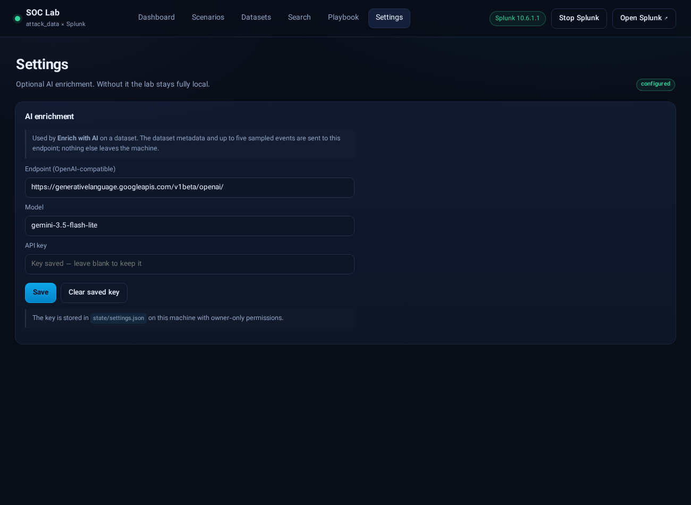
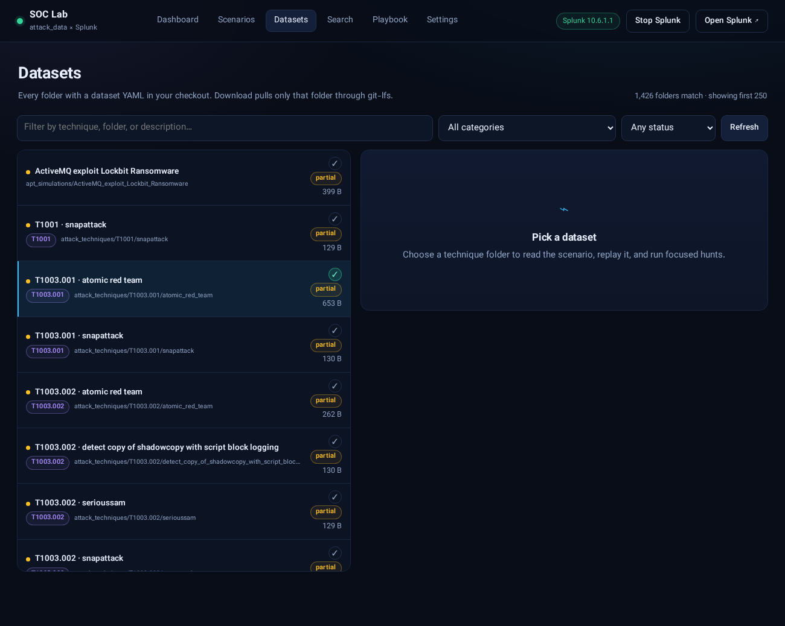
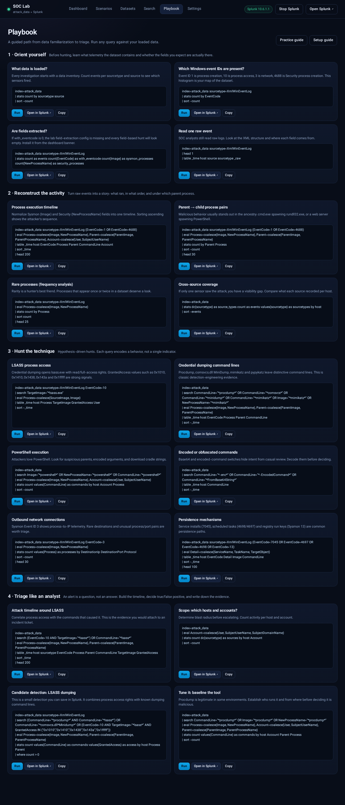

# SOC Lab

A self-contained local SOC practice lab for `splunk/attack_data`:

```
SOC_Lab/  ──►  app.py  ──►  http://127.0.0.1:8765
   │                         │
   ├─ docker-compose.yml ──► Splunk (8000 / 8088 / 8089)
   └─ attack_data/  (cloned on demand, per-folder LFS pulls)
```

The repo ships the UI, the Splunk Compose setup, and the field-extraction
config. The attack-data repository is **not** committed: the app clones its
metadata with Git LFS smudging disabled and only downloads the dataset folders
you select.

## Quick start

Prerequisites: Docker, `git`, `git-lfs`, Python 3.10+.

```bash
python3 -m venv .venv
.venv/bin/pip install -r requirements.txt
docker compose up -d                 # Splunk Web: http://127.0.0.1:8000
.venv/bin/python app.py              # UI:        http://127.0.0.1:8765
```

In the UI:

1. **Clone attack_data** on the dashboard (metadata only, a few MB).
2. **Install field extraction** when the banner asks (no Splunk restart).
3. Open **Datasets** → pick a technique → **Download** → **Replay**.
4. Open **Scenarios** → pick a case → answer each stage. Progress is saved
   locally in `state/scenarios.json`.
5. Open **Playbook** and run the hunts freely.

> Already running the lab from a parent folder that has its own
> `docker-compose.yml`? Start it from there, or use the dashboard's **Start
> Splunk** button; the app keeps the parent Compose project name and volumes.

Splunk's index and HEC token are created automatically on the first replay if
they do not already exist. Use `--port 8766` if 8765 is taken.

## Screenshots

| Dashboard | Datasets | Settings |
|---|---|---|
|  |  |  |

| Dataset detail | Search | Playbook |
|---|---|---|
|  |  |  |

## What you can do

- **Dashboard** — Splunk/API/HEC/field status, next steps, replayed datasets,
  job output, and a danger zone for bulk cleanup.
- **Scenarios** — guided incidents with orient → triage → hunt → scope →
  detection → verdict stages. Search checks run server-side, progress is saved
  per scenario and host, and answers are never sent to the browser.
- **Datasets** — browse and filter technique folders; download one folder at a
  time, replay it, read its YAML metadata, and open host-scoped hunts.
- **Search** — run SPL, inspect result rows, or open the query in Splunk Web.
  Suggested hunts show their title and explanation above the editor so the
  query has context.
- **Playbook** — five phases of ready hunts, from data inventory to triage.
- **Delete** — replay events (per dataset or all), downloaded data files, the
  app-managed clone, and the installed field extraction.

## Docker Compose

`docker-compose.yml` is the canonical lab definition:

- ports `8000` (Web), `8088` (HEC), `8089` (REST)
- named volumes `splunk-etc` / `splunk-var`
- healthcheck and `restart: unless-stopped`
- optional `.env` overrides via `.env.example`

`SPLUNK_HEC_TOKEN` seeds a token on first boot. The app also creates one on
demand, so existing volumes with a different token keep working.

If this repo sits inside a parent project that already has a `docker-compose.yml`
(the development layout), the app uses the parent directory as the Compose
project directory so the existing project name and volumes are preserved.

## attack_data download model

| Action | What happens |
|---|---|
| Clone attack_data | `git clone --depth 1` with `GIT_LFS_SKIP_SMUDGE=1`; no logs downloaded |
| Download dataset | `git lfs pull --include=datasets/<folder>/*` for that one folder |
| Replay dataset | Sends only the YAML-declared files to HEC |

The full repository is >9 GB. Download only the techniques you are practising.
A checkout at `./attack_data` is preferred; `ATTACK_DATA_DIR` can point at an
existing checkout (for example the parent-folder one used during development).

## Scenarios

A scenario is one JSON file in `scenarios/` (see
`scenarios/T1003-001-Credential-dumping-on-a-Windows-host.json`). Names should
identify the technique and case, e.g. `T1003-001-<slug>.json`. The JSON declares
the dataset repository (`dataset.repo`) and folder (`dataset.path`), then walks
5–7 stages. Each stage has a question, optional hints, and hidden checks. The
JSON's `starter_spl` is an authoring reference and is never sent to the browser;
the runner offers **New search** (a fresh, host-scoped SPL editor) and **Open
Splunk** instead. `host="<HOST>"` in hidden SPL is replaced with the dataset's
replay host at request time.

- The scenario list and detail endpoints never return check SPL, accepted
  answers, correct option indexes, or stage debriefs.
- Checks are `search` (server runs hidden SPL), `spl` (runs the student's SPL),
  `answer`, `choice`, and `review` (saved, never blocking).
- Search checks assert presence, not exact counts, so replaying a dataset twice
  does not break them.
- **Set up scenario** does the whole chain in one job: clone the
  repository from `dataset.repo` if needed, start Splunk, download the folder,
  replay it unless the host already has events, wait for indexing, and install
  the field extraction. The step list remains as a manual fallback.
- **Load scenario** accepts a JSON file from disk, validates it, and adds it to
  `scenarios/` under the chosen filename. It refuses duplicate ids, existing
  filenames, and path-like names, so it never overwrites an existing scenario.
- Progress lives in `state/scenarios.json`, keyed by scenario id and replay
  host, and is gitignored. Reset it from the scenario detail view.

To add a scenario, copy the schema from `docs/SCENARIOS_PLAN.md` and follow
`docs/SCENARIO_AUTHORING_AGENT.md`; run every check against the real replay
before committing. The loader validates on every read and hides broken files
with a warning on stderr.

## Field extraction (required for Windows hunts)

`attack_data` replays raw Windows event XML through HEC. The stock
`XmlWinEventLog` sourcetype does not extract `<Data Name="ProcessName">` fields
for HEC-ingested events, so `EventCode`, `Image`, `CommandLine`,
`GrantedAccess` and friends are missing and every field-based hunt is empty.

The dashboard's **Install field extraction** button writes:

- `/opt/splunk/etc/system/local/props.conf`
- `/opt/splunk/etc/system/local/transforms.conf`

inside the `splunk-soc` container (existing files are backed up as
`*.soc_lab.bak`) and reloads them. One dynamic regex maps every
`<Data Name="Field">value</Data>` pair, plus `EventID → EventCode`, `Channel`
and `Computer`. Run it again if the container volumes are recreated.

## Old YAML format

Some folders use the repo's older YAML layout (`dataset:` GitHub URLs instead of
`datasets:` paths). The UI labels these **legacy YAML**, maps each URL to the
matching local file, and infers `sourcetype`/`source` from the YAML hints and the
file contents (an XML `<Channel>` wins). Download the folder first.

## Deleting data

All data the app adds can be removed again:

| Where | Action | What it removes |
|---|---|---|
| Dataset detail | Delete replayed events | Events for that dataset's host via Splunk `\| delete` |
| Dataset detail | Delete downloaded files | Local logs/data in that folder; YAML metadata stays |
| Dashboard → Danger zone | Delete all replayed events | Every event in the lab index |
| Dashboard → Danger zone | Remove cloned attack_data | Only the app-managed `./attack_data` clone |
| Dashboard → Danger zone | Remove field extraction | The SOC Lab `props.conf`/`transforms.conf` stanzas |

Splunk's `delete` command needs the `can_delete` role. The app adds that role to
the configured admin user the first time you delete replayed events (the role
exists in stock Splunk). Deleted events disappear immediately from searches, but
Splunk reclaims disk space only when buckets roll or trim. Deleting downloaded
files is reversible with **Download**; small files tracked outside Git LFS are
restored from `HEAD` as part of that download.

## Configuration

Environment overrides (defaults match `docker-compose.yml`):

| Variable | Default |
|---|---|
| `SPLUNK_HOST` | `127.0.0.1` |
| `SPLUNK_PORT` | `8089` |
| `SPLUNK_WEB_PORT` | `8000` |
| `SPLUNK_USERNAME` | `admin` |
| `SPLUNK_PASSWORD` | `S0cPractice!2026` |
| `SPLUNK_CONTAINER` | `splunk-soc` |
| `SOC_INDEX` | `attack_data` |
| `SOC_COMPOSE_FILE` | `./docker-compose.yml` |
| `ATTACK_DATA_DIR` | `./attack_data` (or the parent checkout) |
| `ATTACK_DATA_REPO` | `https://github.com/splunk/attack_data.git` |

If you change `SPLUNK_PASSWORD` in `.env`, start the app with the same
`SPLUNK_PASSWORD` value. The HEC token is read through the Splunk API.

## Tests

```bash
.venv/bin/python test_app.py
```

Covers legacy YAML mapping, path-traversal rejection, the field-extraction merge
(idempotent), missing-checkout scanning, the recipe file, scenario validation
and sanitization, answer matching, and progress persistence. No network or
Splunk access is required.

## Limits

- No ESCU runner: `security_content` detections need ESCU/ES macros and CIM data
  models that raw HEC replay does not provide. The built-in hunts are
  self-contained SPL instead.
- Replaying the same folder twice duplicates events.
- The server binds to `127.0.0.1` only; it can run arbitrary SPL and Docker
  commands for the local user.

## Layout

```
app.py                  server, Splunk client, dataset scanner, scenarios, jobs
recipes.json            playbook hunts
scenarios/              one JSON scenario per file
splunk_config/          props.conf + transforms.conf installed into Splunk
ui/                     index.html, app.js, style.css (no build step)
docker-compose.yml      Splunk lab
docs/                   SOC practice and setup guides
test_app.py             unittest suite
```

`state/` is created at runtime and is not committed.
