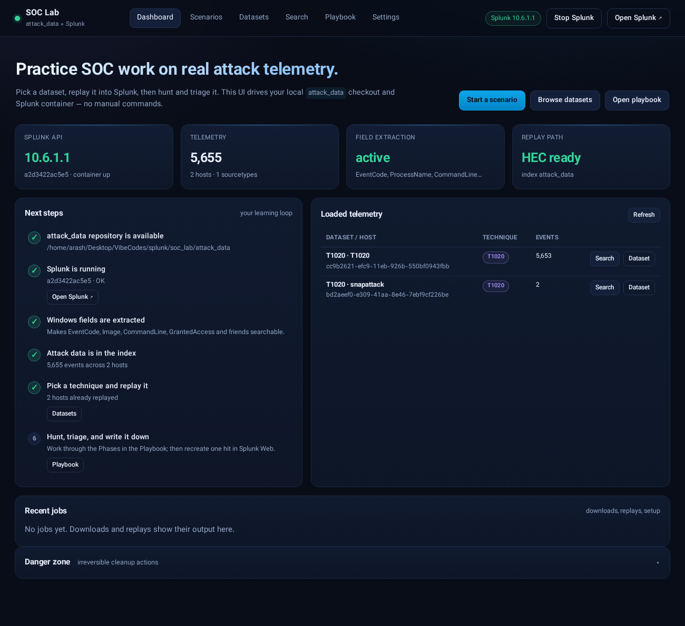
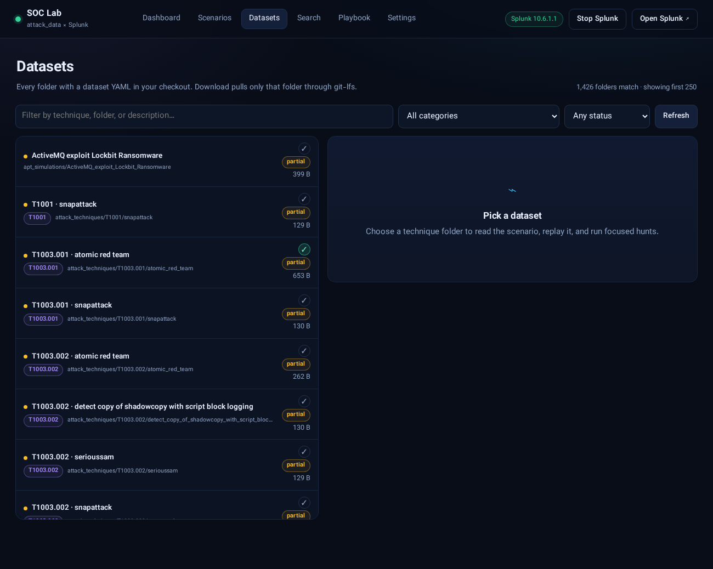
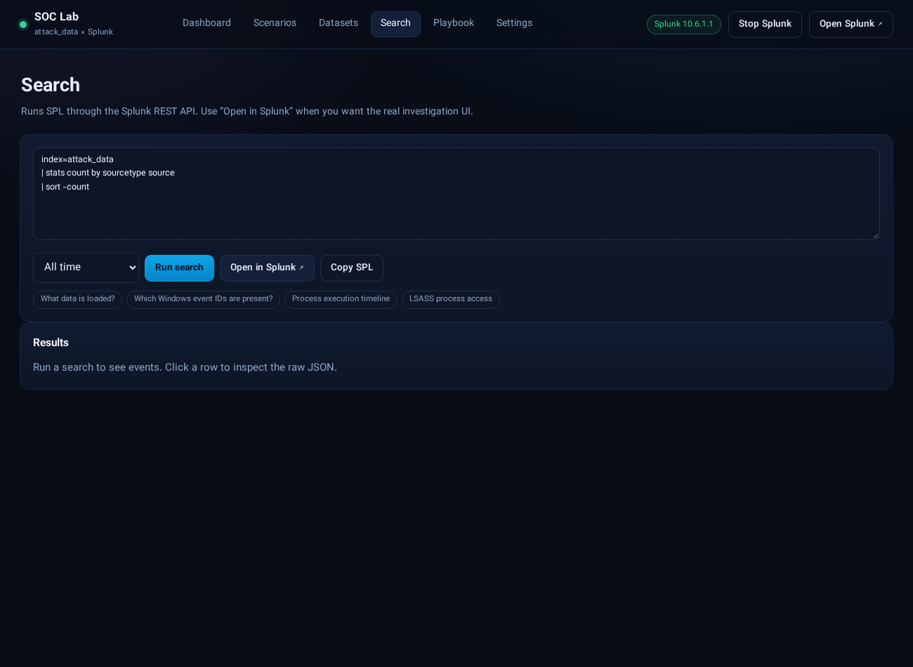

# SOC Lab


A self-contained, local-only SOC practice lab built around Splunk's
[`attack_data`](https://github.com/splunk/attack_data). Browse real attack
telemetry, replay it into a local Splunk instance, and practise detection with
guided scenarios and a curated hunt playbook.

The repository ships the UI, the Splunk Compose setup, and the field-extraction
config. The attack-data repository is **not** committed: the app clones its
metadata with Git LFS smudging disabled and downloads only the dataset folders
you select.



## Contents

- [Features](#features)
- [Screenshots](#screenshots)
- [Quick start](#quick-start)
- [Workflow](#workflow)
- [Architecture](#architecture)
- [Configuration](#configuration)
- [Data lifecycle](#data-lifecycle)
- [attack_data download model](#attack_data-download-model)
- [Scenarios](#scenarios)
- [Field extraction](#field-extraction)
- [Old YAML format](#old-yaml-format)
- [Tests](#tests)
- [Limits](#limits)
- [Layout](#layout)

## Features

- **Dashboard** — Splunk/API/HEC/field status, suggested next steps, replayed
  datasets, job output, and a danger zone for bulk cleanup.
- **Datasets** — browse and filter technique folders, download one folder at a
  time, replay it, read its YAML metadata, and open host-scoped hunts. Track
  progress with a persisted **studied** mark and *Studied / Not studied*
  filters.
- **Scenarios** — guided incidents with orient → triage → hunt → scope →
  detection → verdict stages. Search checks run server-side, progress is saved
  per scenario and host, and answers are never sent to the browser.
- **Search** — run SPL, inspect result rows, or open the query in Splunk Web.
  Suggested hunts show their title and explanation above the editor.
- **Playbook** — five phases of ready hunts, from data inventory to triage.
- **AI enrichment** (optional) — configure an OpenAI-compatible endpoint in
  **Settings**, then use **Enrich with AI** on a dataset to generate a case
  description and host-scoped hunts. Generated hunts are checked against the
  replayed data and unsafe SPL is dropped.
- **Data lifecycle** — delete replayed events, downloaded files, the
  app-managed clone, and the installed field extraction. Stop Splunk from the
  UI without losing replayed data.

## Screenshots

| Datasets | Dataset detail |
|---|---|
|  |  |

| Search | Playbook |
|---|---|
|  |  |

| Settings (AI enrichment) |
|---|
|  |

## Quick start

Prerequisites: Docker, `git`, `git-lfs`, and Python 3.10+.

```bash
python3 -m venv .venv
.venv/bin/pip install -r requirements.txt
docker compose up -d                 # Splunk Web: http://127.0.0.1:8000
.venv/bin/python app.py              # UI:        http://127.0.0.1:8765
```

> Running the lab from a parent folder that already has its own
> `docker-compose.yml`? Start it from there, or use the dashboard's **Start
> Splunk** button. The app keeps the parent Compose project name and volumes.

Splunk's index and HEC token are created automatically on the first replay if
they do not already exist. Use `--port 8766` if 8765 is taken.

## Workflow

1. **Clone attack_data** on the dashboard (metadata only, a few MB).
2. **Install field extraction** when the banner asks (no Splunk restart).
3. Open **Datasets** → pick a technique → **Download** → **Replay**.
4. Open **Scenarios** → pick a case → answer each stage. Progress is saved
   locally in `state/scenarios.json`.
5. Open **Playbook** and run the hunts freely.

## Architecture

```
SOC_Lab/  ──►  app.py  ──►  http://127.0.0.1:8765
  │                         │
  ├─ docker-compose.yml ──► Splunk (8000 / 8088 / 8089)
  └─ attack_data/  (cloned on demand, per-folder LFS pulls)
```

- `app.py` is a local-only server built on Python's `http.server` with a
  Splunk REST client, dataset scanner, and background job runner.
- The UI is vanilla HTML/CSS/JS with no build step.
- Splunk runs from the canonical `docker-compose.yml` with named volumes, a
  healthcheck, and `restart: unless-stopped`.
- The server binds to `127.0.0.1` only. It can run arbitrary SPL and Docker
  commands for the local user.

## Configuration

Environment overrides (defaults match `docker-compose.yml`):

| Variable | Default |
|---|---|
| `SPLUNK_HOST` | `127.0.0.1` |
| `SPLUNK_PORT` | `8089` |
| `SPLUNK_WEB_PORT` | `8000` |
| `SPLUNK_USERNAME` | `admin` |
| `SPLUNK_PASSWORD` | `S0cPractice!2026` |
| `SPLUNK_CONTAINER` | `splunk-soc` |
| `SOC_INDEX` | `attack_data` |
| `SOC_COMPOSE_FILE` | `./docker-compose.yml` |
| `ATTACK_DATA_DIR` | `./attack_data` (or the parent checkout) |
| `ATTACK_DATA_REPO` | `https://github.com/splunk/attack_data.git` |

If you change `SPLUNK_PASSWORD` in `.env`, start the app with the same
`SPLUNK_PASSWORD` value. The HEC token is read through the Splunk API. An
optional `.env` is read via `.env.example`.

## Data lifecycle

All data the app adds can be removed again:

| Where | Action | What it removes |
|---|---|---|
| Dataset detail | Delete replayed events | Events for that dataset's host via Splunk `\| delete` |
| Dataset detail | Delete downloaded files | Local logs/data in that folder; YAML metadata stays |
| Dashboard → Danger zone | Delete all replayed events | Every event in the lab index |
| Dashboard → Danger zone | Remove cloned attack_data | Only the app-managed `./attack_data` clone |
| Dashboard → Danger zone | Remove field extraction | The SOC Lab `props.conf`/`transforms.conf` stanzas |

Splunk's `delete` command needs the `can_delete` role. The app adds that role to
the configured admin user the first time you delete replayed events (the role
exists in stock Splunk). Deleted events disappear immediately from searches, but
Splunk reclaims disk space only when buckets roll or trim. Deleting downloaded
files is reversible with **Download**; small files tracked outside Git LFS are
restored from `HEAD` as part of that download.

## attack_data download model

| Action | What happens |
|---|---|
| Clone attack_data | `git clone --depth 1` with `GIT_LFS_SKIP_SMUDGE=1`; no logs downloaded |
| Download dataset | `git lfs pull --include=datasets/<folder>/*` for that one folder |
| Replay dataset | Sends only the YAML-declared files to HEC |

The full repository is >9 GB. Download only the techniques you are practising.
A checkout at `./attack_data` is preferred; `ATTACK_DATA_DIR` can point at an
existing checkout (for example the parent-folder one used during development).

## Scenarios

A scenario is one JSON file in `scenarios/` (see
`scenarios/T1003-001-Credential-dumping-on-a-Windows-host.json`). Names should
identify the technique and case, e.g. `T1003-001-<slug>.json`. The JSON declares
the dataset repository (`dataset.repo`) and folder (`dataset.path`), then walks
5–7 stages. Each stage has a question, optional hints, and hidden checks. The
JSON's `starter_spl` is an authoring reference and is never sent to the browser;
the runner offers **New search** (a fresh, host-scoped SPL editor) and **Open
Splunk** instead. `host="<HOST>"` in hidden SPL is replaced with the dataset's
replay host at request time.

- The scenario list and detail endpoints never return check SPL, accepted
  answers, correct option indexes, or stage debriefs.
- Checks are `search` (server runs hidden SPL), `spl` (runs the student's SPL),
  `answer`, `choice`, and `review` (saved, never blocking).
- Search checks assert presence, not exact counts, so replaying a dataset twice
  does not break them.
- **Set up scenario** does the whole chain in one job: clone the repository from
  `dataset.repo` if needed, start Splunk, download the folder, replay it unless
  the host already has events, wait for indexing, and install the field
  extraction. The step list remains as a manual fallback.
- **Load scenario** accepts a JSON file from disk, validates it, and adds it to
  `scenarios/` under the chosen filename. It refuses duplicate ids, existing
  filenames, and path-like names, so it never overwrites an existing scenario.
- Progress lives in `state/scenarios.json`, keyed by scenario id and replay host,
  and is gitignored. Reset it from the scenario detail view.

To add a scenario, copy the schema from `docs/SCENARIOS_PLAN.md` and follow
`docs/SCENARIO_AUTHORING_AGENT.md`; run every check against the real replay
before committing. The loader validates on every read and hides broken files
with a warning on stderr.

## Field extraction

`attack_data` replays raw Windows event XML through HEC. The stock
`XmlWinEventLog` sourcetype does not extract `<Data Name="ProcessName">` fields
for HEC-ingested events, so `EventCode`, `Image`, `CommandLine`,
`GrantedAccess` and friends are missing and every field-based hunt is empty.

The dashboard's **Install field extraction** button writes:

- `/opt/splunk/etc/system/local/props.conf`
- `/opt/splunk/etc/system/local/transforms.conf`

inside the `splunk-soc` container (existing files are backed up as
`*.soc_lab.bak`) and reloads them. One dynamic regex maps every
`<Data Name="Field">value</Data>` pair, plus `EventID → EventCode`, `Channel`
and `Computer`. Run it again if the container volumes are recreated.

## Old YAML format

Some folders use the repository's older YAML layout (`dataset:` GitHub URLs
instead of `datasets:` paths). The UI labels these **legacy YAML**, maps each URL
to the matching local file, and infers `sourcetype`/`source` from the YAML hints
and the file contents (an XML `<Channel>` wins). Download the folder first.

## Tests

```bash
.venv/bin/python test_app.py
```

Covers legacy YAML mapping, path-traversal rejection, the field-extraction merge
(idempotent), missing-checkout scanning, the recipe file, scenario validation
and sanitization, answer matching, progress persistence, AI enrichment parsing,
and studied-state persistence. No network or Splunk access is required.

## Limits

- No ESCU runner: `security_content` detections need ESCU/ES macros and CIM data
  models that raw HEC replay does not provide. The built-in hunts are
  self-contained SPL instead.
- Replaying the same folder twice duplicates events.
- The server binds to `127.0.0.1` only; it can run arbitrary SPL and Docker
  commands for the local user.
- AI enrichment is optional and off by default. When enabled, dataset metadata
  and up to five sampled events are sent to the configured endpoint.

## Layout

```
app.py                  server, Splunk client, dataset scanner, scenarios, jobs
recipes.json            playbook hunts
scenarios/              one JSON scenario per file
splunk_config/          props.conf + transforms.conf installed into Splunk
ui/                     index.html, app.js, style.css (no build step)
screenshots/            README screenshots
docker-compose.yml      Splunk lab
docs/                   SOC practice, setup, and scenario authoring guides
test_app.py             unittest suite
```

`state/` is created at runtime and is not committed.
